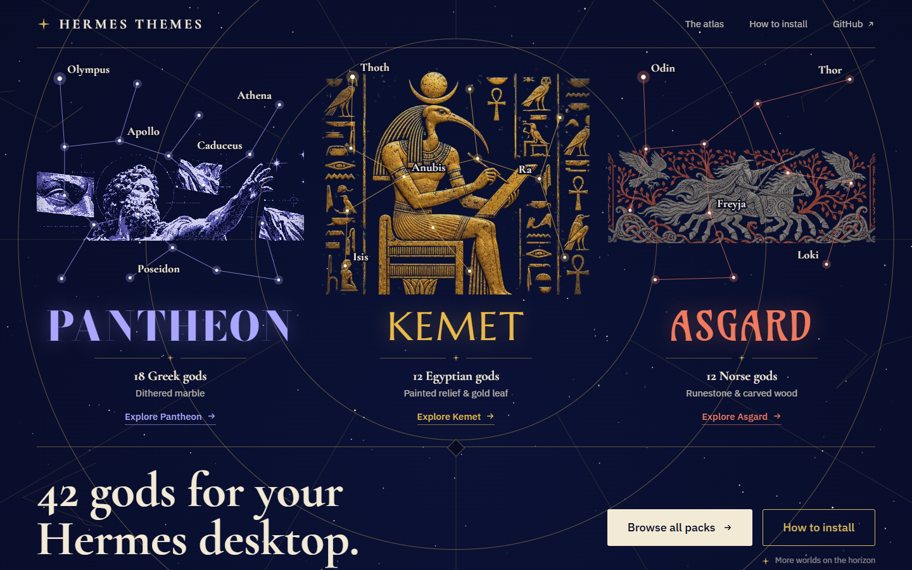

<div align="center">

  <a href="https://github.com/NousResearch/hermes-agent">
    
  </a>

  # Hermes Themes

  **42 gods for your Hermes desktop.**

  Community theme packs for Hermes Desktop, each one a whole mythology.
  Every god brings its own art, palette and lettering.

  <sub>FOR <a href="https://github.com/NousResearch/hermes-agent">HERMES DESKTOP</a> &nbsp;·&nbsp; COMMUNITY THEMES &nbsp;·&nbsp; 3 PACKS</sub>

  <br /><br />

  [Open the star atlas](https://adolanium.github.io/hermes-themes/) &nbsp;·&nbsp; [The packs](#the-packs) &nbsp;·&nbsp; [Install one](#install-one)

</div>

[](https://adolanium.github.io/hermes-themes/)

## The packs

| Pack | Gods | Look | Repo |
| --- | --- | --- | --- |
| [**Pantheon**](https://adolanium.github.io/hermes-pantheon/) | 18 Greek: all twelve Olympians, plus Hades, Nyx, Helios, Selene and Medusa | Dithered marble | [hermes-pantheon](https://github.com/Adolanium/hermes-pantheon) |
| [**Kemet**](https://adolanium.github.io/hermes-kemet/) | 12 Egyptian, from Thoth to Hathor | Painted relief and gold leaf | [hermes-kemet](https://github.com/Adolanium/hermes-kemet) |
| [**Asgard**](https://adolanium.github.io/hermes-asgard/) | 12 Norse, from Odin to Bragi | Runestone and carved wood | [hermes-asgard](https://github.com/Adolanium/hermes-asgard) |

The packs install side by side, and no two gods share a name, so every god shows up in the same theme picker.

## Install one

In Hermes Desktop, open **Capabilities → Plugins**, click **Install from Git** and paste a pack's repo address. Or use the terminal:

```sh
hermes plugins install hermes-pantheon
hermes plugins install Adolanium/hermes-kemet
hermes plugins install Adolanium/hermes-asgard
```

Then flip the pack's **Desktop** switch on in **Capabilities → Plugins**, and type `/skin` with a god's name in the message box, like `/skin thoth`. Each pack's README has the full details.

Pantheon is in the official Hermes plugin catalog, so it installs by name. Kemet and Asgard are in catalog review.

<br />

<div align="center">
  <strong>Hermes Themes</strong><br />
  <sub>More worlds on the horizon.</sub>
</div>

<br />

## License

[MIT](LICENSE). The site's fonts are under the SIL Open Font License.

> **Community project**
>
> Hermes Themes is an independent community project. It is not affiliated with, endorsed by, sponsored by, or officially associated with [Nous Research](https://github.com/NousResearch) or the [Hermes Agent project](https://github.com/NousResearch/hermes-agent). Hermes, Hermes Agent, and Nous Research are names and marks belonging to their respective owners.
